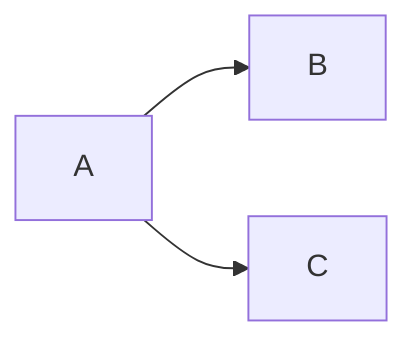

# Code

Hello, World! This is my first blog entry.

```python
def greet(name: str):
    print(f"Hello, {name}!")

if __name__ == "__main__":
    greet("Stefan")
```

Simple flowchart diagram using [mermaid][mermaid]:



[mermaid]: https://mermaid.js.org/syntax/flowchart.html
