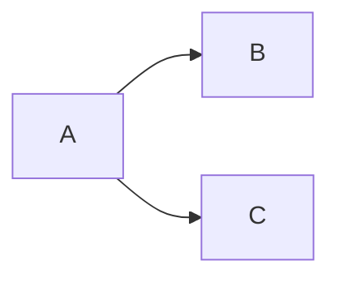

# Usage

Your content tree is your site: the name and the position of each file decide what it becomes, so you write no
templates and maintain no manifest. One command builds it:

```sh
gelyn build
```

Settings and the layers they come from are documented in `configuration.md`, and streams, exit codes, and tab
completion in `cli.md`. This page covers what Gelyn does with a content tree once you point it at one.

## Content tree

```text
content/
    index.md         -> index.html
    about.md         -> about.html
    robots.txt       -> robots.txt
    blog/
        index.md     -> blog/index.html
        hello.md     -> blog/hello.html
        diagram.png  -> blog/diagram.png
```

Gelyn renders your Markdown and publishes it under the same name with an `.html` extension. Everything else it
copies byte for byte under the name it already has, which is what lets a `robots.txt`, a `CNAME`, or an image
beside the post that uses it work without a setting. Either way, Gelyn mirrors your directories.

Position is the only thing that decides where a file lands. No front matter key overrides the output path, and
nothing flattens or re-nests a directory.

> [!IMPORTANT]
> `content/index.md` is required. Without it, Gelyn stops before writing anything, reporting
> `error: No landing page found at '...'` and exiting with code 1. Every other file is optional.

## Front matter

Open a Markdown file with a YAML block to declare any of five keys:

```markdown
---
title: About
date: 2026-09-14
description: Who I am and what I write about
enableMathRendering: true
enableDiagramRendering: true
---
```

| Key                      | Description                                                                           |
| ------------------------ | ------------------------------------------------------------------------------------- |
| `title`                  | Titles the document and labels its navigation entry. See [Page titles](#page-titles). |
| `date`                   | Fills the `revised` meta tag, in `yyyy-MM-dd` form.                                   |
| `description`            | Fills the `description` meta tag, in place of the one configured for your site.       |
| `enableMathRendering`    | Loads KaTeX on this page alone. See [Mathematics](#mathematics).                      |
| `enableDiagramRendering` | Loads Mermaid on this page alone. See [Diagrams](#diagrams).                          |

Three rules are worth knowing, because none of them produces a warning:

- Open the block on the very first line. With one blank line above it, Gelyn no longer reads it as front
  matter. It renders the delimiters and the keys as content, and the title falls back to the file name.
- Gelyn ignores a key it doesn't know, so `titel:` loses your title in silence.
- Gelyn drops a `date` it can't parse the same way, and writes the page without a `revised` tag.

A block that isn't well-formed YAML, or that holds something other than key-value pairs, does stop the build.
Gelyn exits with code 1 and writes nothing, because it renders every page before it writes the first one. The
message comes from the YAML reader, which names neither the file nor the line.

A `date` is metadata and nothing more. It orders no page and generates no listing, so a section index links its
pages because its Markdown says so.

## Page titles

Gelyn resolves the title of a page in three steps, and the first match wins:

1. `title` in the front matter.
2. The name of the containing folder, when the file is a section `index.md`.
3. The file name without its extension.

So `blog/index.md` is titled `blog`, and `blog/hello-world.md` is titled `hello-world`. The landing page is the
one case where the fallback is rarely what you want. `content/index.md` has no folder above it, so it lands on
the file name, and your navigation reads `index` until the front matter declares something else.

## Navigation

Every page carries the same banner: your site title linking back to the landing page, then one entry per linked
page. Depth alone decides what Gelyn links.

| Page                 | Linked | Reason                                       |
| -------------------- | ------ | -------------------------------------------- |
| `index.md`           | Yes    | The landing page.                            |
| `about.md`           | Yes    | A page at the root of the content directory. |
| `blog/index.md`      | Yes    | A section index, one level down.             |
| `blog/hello.md`      | No     | A page inside a section.                     |
| `blog/2026/index.md` | No     | An index below the first level.              |

No front matter key opts a page in or out, so link anything the banner leaves out yourself.

Entries follow the order Gelyn walks the tree: the landing page first, then the remaining root-level pages,
then one entry per section. Within a directory, Gelyn compares names ordinally, which sorts every uppercase
name ahead of every lowercase one, so `Archive.md` precedes `about.md`.

The entry for the page being rendered carries [`aria-current="page"`][aria-current], which is your hook for
styling it.

## Markdown

Gelyn renders your Markdown with [Markdig][markdig]: CommonMark plus the following
[extensions][markdig-extensions], which are fixed rather than configurable per site.

| Extension         | Syntax                   | Output                                                    |
| ----------------- | ------------------------ | --------------------------------------------------------- |
| Alert blocks      | `> [!NOTE]`              | A GitHub style callout, icon included                     |
| Abbreviations     | `*[HTML]: HyperText ...` | `<abbr title="...">` around every later mention           |
| Auto identifiers  | `## A Heading`           | `id="a-heading"`, GitHub style                            |
| Citations         | `""quoted""`             | `<cite>`                                                  |
| Definition lists  | `Term`, then `:   Text`  | `<dl>`, `<dt>`, `<dd>`                                    |
| Strikethrough     | `~~text~~`               | `<del>`                                                   |
| Figures           | `^^^` fences             | `<figure>`, with a `<figcaption>` per fence that is named |
| Footers           | `^^ text`                | `<footer>`                                                |
| Footnotes         | `[^1]`                   | A reference, and a back-linked note at the end            |
| Mathematics       | `$x$`, `$$x$$`           | `<span class="math">`, `<div class="math">`               |
| Pipe tables       | `a \| b`                 | `<table>`, under GFM rules                                |
| List extras       | `a.`, `i.`               | `<ol type="a">`, `<ol type="i">`                          |
| Task lists        | `- [x] done`             | A disabled checkbox                                       |
| Diagrams          | `` ```mermaid ``         | `<pre class="mermaid">`                                   |
| Auto links        | `www.example.com`        | A link, with `https` for a `www` host                     |
| YAML front matter | `---`                    | Read as front matter, and left out of the body            |

Two of these need more care than the table suggests. Indent a definition far enough that its text starts at the
fourth column, so `:   Text` makes a definition list and `: Text` makes a paragraph. Strikethrough is the only
emphasis extra switched on, so `==mark==`, `^super^`, and `~sub~` render as the literal characters.

Raw HTML passes through, blocks and inline alike, and Gelyn still renders Markdown inside a block element as
long as a blank line separates the two.

> [!NOTE]
> Mathematics and diagrams emit markup for a client-side renderer, so both reach the browser as literal text
> until one loads. Each has a front matter key that loads one for you, [KaTeX][katex] under
> [Mathematics](#mathematics) and [Mermaid][mermaid] under [Diagrams](#diagrams).

Fenced code blocks carry their info string as a `language-*` class on the `<code>` element. Nothing tokenizes
the code, so color it by styling the block as a whole, or load a highlighter the same way.

## Document shell

Every page is the same document around your own body:

```html
<!DOCTYPE html>
<html lang="en">
<head>
    <!-- charset, viewport, generator, author, description, revised, canonical, title, stylesheets, scripts -->
</head>
<body>
    <header>
        <a href="/index.html">Site title</a>
        <nav><ul><li><a href="/about.html">About</a></li></ul></nav>
    </header>
    <main>
        <!-- the rendered Markdown -->
    </main>
    <hr />
    <footer>
        <em>Built with Gelyn v0.1.0 on Oct 10, 2026</em>
    </footer>
</body>
</html>
```

Gelyn leaves out a tag whose value it doesn't have rather than writing it empty, so a page with no `date`
carries no `revised` tag, and a site with no `BaseUrl` no canonical link.

The shell declares no classes of its own. Style it through the elements, `aria-current="page"`, and the classes
Markdig emits: `markdown-alert`, `contains-task-list`, `footnotes`, `math`, `mermaid`, and `language-*`.

## Stylesheets

Gelyn copies a `.css` file in your content tree like any other file, and additionally links it from every page
in its directory and in every directory below it. Placement is the whole mechanism, and you declare nothing.

```text
content/
    styles.css
    index.md
    about.md
    blog/
        blog.css
        index.md
        2026/
            year.css
            index.md
    notes/
        notes.md
```

| Page                   | Links                                                  |
| ---------------------- | ------------------------------------------------------ |
| `index.html`           | `/styles.css`                                          |
| `about.html`           | `/styles.css`                                          |
| `blog/index.html`      | `/styles.css`, `/blog/blog.css`                        |
| `blog/2026/index.html` | `/styles.css`, `/blog/blog.css`, `/blog/2026/year.css` |
| `notes/notes.html`     | `/styles.css`                                          |

Gelyn writes the links outermost first, so a rule deeper in the tree overrides the one above it, and the
cascade follows the shape of your content. It never reaches a sibling branch, which is why `blog.css` applies
to nothing under `notes/`.

Gelyn links several stylesheets in one directory in ordinal name order, the same comparison the navigation
uses, and matches the extension without regard to case, so `.CSS` counts.

No stylesheet ships with Gelyn, so a tree with no `.css` in it produces a correct but unstyled site.

## Scripts

A `.js` file cascades exactly as a stylesheet does. Drop `app.js` at the content root and every page loads it;
drop `blog/charts.js` and every page in `blog/` and below loads both:

```text
content/
    app.js
    index.md
    blog/
        charts.js
        index.md
        2026/
            index.md
```

| Page                   | Loads                           |
| ---------------------- | ------------------------------- |
| `index.html`           | `/app.js`                       |
| `blog/index.html`      | `/app.js`, `/blog/charts.js`    |
| `blog/2026/index.html` | `/app.js`, `/blog/charts.js`    |

Gelyn writes each one as `<script defer src="...">` in the head, outermost first:

```html
<script defer src="/app.js"></script>
<script defer src="/blog/charts.js"></script>
```

Deferred scripts run in document order, so outermost first means a script at the root runs before one further
down can depend on it. `defer` is not optional, because a script you placed rather than requested shouldn't
block the parser.

Everything the stylesheet rule says applies here too: a sibling branch is never reached, several scripts in
one directory load in ordinal name order, the extension is matched without regard to case, and the file is
copied whether any page loads it or not.

> [!IMPORTANT]
> Ordinal name order is the one thing to watch, because it has nothing to do with dependency order. Two
> scripts in the same directory load alphabetically, so `auto-render.min.js` loads before `katex.min.js` and
> executes before the library it needs. Name them so the alphabet agrees with the dependency, such as
> `1-katex.min.js` and `2-auto-render.min.js`, or put the library one directory up where the cascade reaches
> it first.

> [!NOTE]
> The cascade reaches no CDN, because placement is its only mechanism. To use a library, put its `.js` in your
> content tree and let the cascade pick it up. That costs a file in your repository and buys a site with no
> third-party requests. KaTeX and Mermaid are the two libraries Gelyn fetches for you, through the keys
> described next.

## Mathematics

Markdown that carries math renders to markup a browser shows as literal text, so a page with math needs a
renderer. Declare one key to get [KaTeX][katex]:

```markdown
---
title: Euler
enableMathRendering: true
---

Everyone loves $\pi$. Have a look at this beautiful equation:

$$
e^{i\pi} + 1 = 0
$$
```

Gelyn writes three tags into the head of that page, which are the ones KaTeX's own
[browser documentation][katex-browser] prescribes:

```html
<link rel="stylesheet" href="https://cdn.jsdelivr.net/npm/katex@0.19.0/dist/katex.min.css">
<script defer src="https://cdn.jsdelivr.net/npm/katex@0.19.0/dist/katex.min.js"></script>
<script defer src="https://cdn.jsdelivr.net/npm/katex@0.19.0/dist/contrib/auto-render.min.js" onload="renderMathInElement(document.body);"></script>
```

The last one scans the document once it has loaded and typesets everything between the delimiters, which are
already the delimiters Markdig emits. You configure nothing else.

`KaTeXVersion` in `gelyn.json` sets the version in all three URLs, so you can move to a newer KaTeX without
waiting for a release of Gelyn. It defaults to `0.19.0`.

Unlike a stylesheet or a script, this key doesn't cascade. Declare it on each page that carries math, and a
page that doesn't carries no KaTeX and makes no request for it. Nothing inherits it from the section index
above it.

> [!NOTE]
> Gelyn writes no `integrity` attribute, because a Subresource Integrity hash pins one exact file and the
> version is yours to change. If you'd rather your site made no third-party request at all, leave the key
> unset, put `katex.min.css`, `katex.min.js`, and `auto-render.min.js` in your content tree, and let
> [Scripts](#scripts) and [Stylesheets](#stylesheets) load them. Mind the load order that section warns about,
> and remember that vendoring needs one line of your own to call `renderMathInElement`.

## Diagrams

A fenced `mermaid` block renders to `<pre class="mermaid">`, which is the element [Mermaid][mermaid] looks for
and nothing else acts on. Declare one key to get the renderer:

````markdown
---
title: Pipeline
enableDiagramRendering: true
---


````

Gelyn writes one module script into the head of that page, which is the form Mermaid's own
[documentation][mermaid-docs] prescribes:

```html
<script type="module">
import mermaid from "https://cdn.jsdelivr.net/npm/mermaid@12.1.0/dist/mermaid.esm.min.mjs";
mermaid.initialize({ startOnLoad: true });
</script>
```

`startOnLoad` is what finds every `<pre class="mermaid">` on the page and replaces it with SVG, so you
configure nothing else. A module script defers on its own, which is why this one carries no `defer`.

`MermaidVersion` in `gelyn.json` sets the version in that URL. It defaults to `12.1.0`.

The key doesn't cascade, so declare it on each page that carries a diagram, and Gelyn writes no `integrity`
attribute, because the version is yours to change. Vendoring Mermaid instead isn't an option: it loads as an
ES module, and [Scripts](#scripts) emits a plain `<script src>`, which can't carry one.

## Rebuilds

A build overwrites the files it produces and leaves everything else in your output directory alone, so a page
whose source you renamed or deleted stays published under its old name until you remove it. Run `gelyn clean`
to get an output directory that holds nothing but your current sources.

Every page also carries the build date in its footer and the tool version in its generator tag, so a build on a
later day rewrites every page even when no source changed. Worth knowing if you commit your output directory or
deploy it by diff.

<!-- References -->

[markdig]: https://github.com/xoofx/markdig
[markdig-extensions]: https://xoofx.github.io/markdig/docs/extensions/
[katex]: https://katex.org
[katex-browser]: https://katex.org/docs/browser
[mermaid]: https://mermaid.js.org
[mermaid-docs]: https://mermaid.js.org/intro/getting-started.html
[aria-current]: https://developer.mozilla.org/en-US/docs/Web/Accessibility/ARIA/Attributes/aria-current
