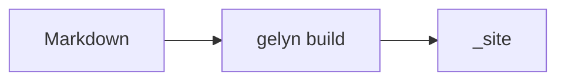

# Code

A fence carries its info string as a `language-*` class. Nothing tokenizes the code, so style the block as a
whole or load a highlighter the same way you would any script.

```python
def greet(name: str):
    print(f"Hello, {name}!")

if __name__ == "__main__":
    greet("Stefan")
```

## Diagrams

A flowchart using [mermaid][mermaid]:



The markup reaches the browser as literal text unless the page declares `enableDiagramRendering: true`.

## Alerts

> [!NOTE]
> `NOTE`, `TIP`, `IMPORTANT`, `WARNING` and `CAUTION` all render, icon included.

> [!WARNING]
> The marker has to be the first line of the quote.

[mermaid]: https://mermaid.js.org/syntax/flowchart.html
