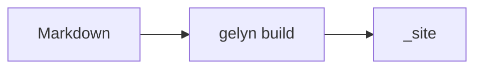
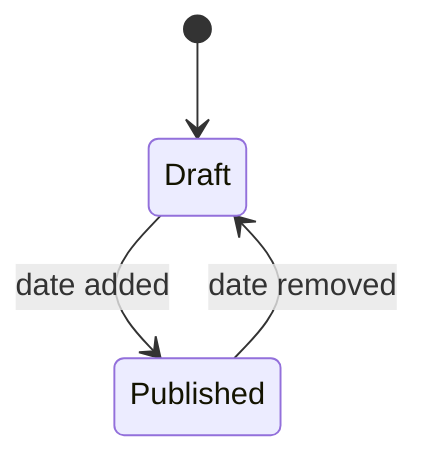

# Diagrams

A fence tagged `mermaid` is handed to [mermaid][mermaid] in the browser instead of being printed as code:

The markup reaches the browser as literal text unless the page declares `enableDiagramRendering: true`. This
page does; the index above it does not, because the flag applies to the page that declares it and is inherited
by nothing.

[mermaid]: https://mermaid.js.org/syntax/flowchart.html
