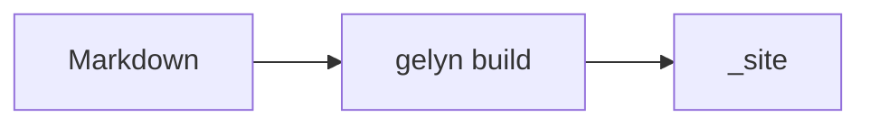

# Hello

Written by {{AUTHOR}}. This post exercises the extensions gelyn enables; delete it once you have your own.

## Text

~~Strikethrough~~ is the only emphasis extra enabled, so `==mark==`, `^super^` and `~sub~` stay literal.
A footnote[^1] links in both directions, and a bare host like www.example.com becomes an anchor.

*[SSG]: Static Site Generator

Gelyn is an SSG, and every later mention of SSG carries the title.

Front matter
:   A YAML block at the top of the file. Its text starts at the fourth column, or this is a paragraph
    rather than a definition.

Headings get GitHub style identifiers, so [Tables](#tables) links within the page.

Citations, figures, footers and alphabetic lists are enabled too. The table in `usage.md` has them.

## Code

A fence carries its info string as a `language-*` class. Nothing tokenizes the code, so style the block as a
whole or load a highlighter the same way you would any script.

```csharp
public static int Add(int left, int right) => left + right;
```

## Mathematics

Inline $E = mc^2$, and a block:

$$
\int_0^\infty e^{-x^2} \, dx = \frac{\sqrt{\pi}}{2}
$$

Both reach the browser as literal text unless the page declares `enableMathRendering: true`.

## Diagrams



Same arrangement: `enableDiagramRendering: true` loads the renderer.

## Alerts

> [!NOTE]
> `NOTE`, `TIP`, `IMPORTANT`, `WARNING` and `CAUTION` all render, icon included.

> [!WARNING]
> The marker has to be the first line of the quote.

## Tables

| Setting            | Default   |
| ------------------ | --------- |
| `ContentDirectory` | `content` |
| `OutputDirectory`  | `_site`   |

## Lists

- [x] A task list renders a disabled checkbox
- [ ] Unchecked as well

[^1]: And lands here.
